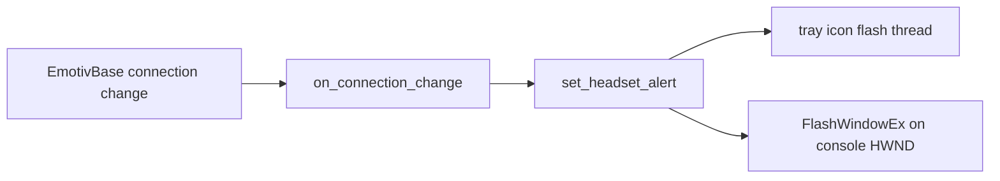

# Taskbar flash for EEG disconnect

## Context

The disconnect UX lives in Python [`emotiv-lsl/main.py`](c:\Users\pho\repos\EmotivEpoc\ACTIVE_DEV\emotiv-lsl\main.py), not the C++ tree. Tray flash already works via `set_headset_alert()` → `_flash_loop()`. Connection transitions come from [`emotiv_lsl/emotiv_base.py`](c:\Users\pho\repos\EmotivEpoc\ACTIVE_DEV\emotiv-lsl\emotiv_lsl\emotiv_base.py) through `on_connection_change`.

The taskbar button in your screenshot is the **console window** (`GetConsoleWindow()`). The app already has that HWND for show/hide/minimize-to-tray.

## Approach

Use Win32 `FlashWindowEx` on the console HWND when the headset alert turns on, and `FLASHW_STOP` when it turns off. Hook this inside `set_headset_alert()` so tray and taskbar stay in sync.

**Flash behavior (chosen to match tray):** keep flashing for the whole disconnect period (`FLASHW_ALL | FLASHW_TIMER`), not only until the console is focused. Stop only on reconnect / exit (`set_headset_alert(False)`).

## Changes (single file)

In [`main.py`](c:\Users\pho\repos\EmotivEpoc\ACTIVE_DEV\emotiv-lsl\main.py):

1. Add a small Windows-only helper, e.g. `_flash_taskbar(active: bool)`, near `_get_console_hwnd()`:
   - Define `FLASHWINFO` via `ctypes.Structure`
   - Flags: `FLASHW_STOP=0`, `FLASHW_ALL=3`, `FLASHW_TIMER=4`
   - On `active=True`: `FlashWindowEx` with `FLASHW_ALL | FLASHW_TIMER`, `uCount=0` (until stopped)
   - On `active=False`: `FlashWindowEx` with `FLASHW_STOP`
   - No-op if not Windows or HWND is missing
2. Call `_flash_taskbar(should_flash)` from `set_headset_alert()` after updating `_alert_active` (and before/after tray title updates — order does not matter).
3. Leave tray flash, minimize-to-tray hook, and `emotiv_base.py` unchanged.

## Notes

- When the console is **hidden** to the tray (`SW_HIDE`), Windows usually removes the taskbar button; tray flash remains the signal. Taskbar flash applies when the console/taskbar entry is visible (your screenshot case).
- No new deps; reuse existing `ctypes` Win32 usage.
- Exit path already calls `set_headset_alert(False)`, which will stop taskbar flashing.